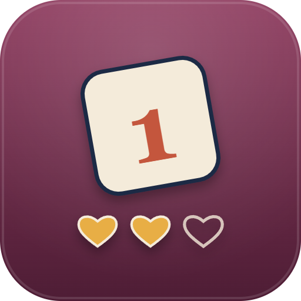

# StripDeathroll14



A host helper for Strip Deathroll at FFXIV venues: it keeps the turn order, calls each player to roll, catches wrong rolls, and tracks pieces and round history.

`/sdr` · Dalamud API 15 · .NET 10

> **No support will be provided. This software is to be used as is, without warranty of any kind.**

## What it does

- **Private or Public** — a dropdown. Private room: calls go to `/s` and players roll `/random N`. Public: calls go to `/p` (or `/a` when you are in an alliance) and players roll `/dice party N` / `/dice alliance N`, so the rolls stay in the group. Rolls are read in every form either way.
- **Player list** — add everyone in your party or alliance (cross-world parties included) with one button, or type names in as `Forename Surname`. Remove (Ctrl+click) and move players up or down; the list *is* the turn order.
- **Opening roll** — *Start round* proposes "everyone roll /random". When every active player has rolled, the list sorts high to low and the highest goes first with a fresh `/random`. A tie for first is flagged so you can reorder.
- **Turn calls** — it proposes `Name, roll /random` for the starter, then `Name, roll /random N`, where N is the previous player's roll, looping the list.
- **Alerts** — a roll with the wrong number (`out of 999` when 532 was expected), a roll out of turn, a second opening roll, or a non-bare opening roll prints a `[Deathroll]` line in Echo and shows in red in the window. A wrong-number roll waits for you: *Accept* it or *Ask for reroll*.
- **Round end** — a 1, 69 or 666 wins the round. The window asks *Who strips?* from the active players (not the winner); that player loses one of 3 pieces, at 0 they are out, and the next round's opening call follows. One player left is game over.
- **History** — every round: winner, winning roll, who stripped, pieces left. Wins per player are in the list.
- **Rules & Ad** — two saved texts, posted one chat line per text line (up to 10) to Say, Yell or Party.
- **Roll for me** — when it is your roll, one press (or `/sdr roll` from a hotbar macro) sends the right command: a fresh `/random` for the opening roll or when you start the turns, otherwise `/random N` to the previous roll (`/dice party|alliance` in Public). The button shows the command it will send; a second press for the same turn within 10 s is ignored, so a double press never rolls twice.

### What it is not meant to do

- **It does not roll for anyone but you,** and it rolls for you only when you press *Roll for me* or run `/sdr roll`.
- **It does not post on its own unless you turn on Auto-post.** By default every call and result waits in the window for *Post*.
- **It does not choose who strips.** That is the winner's call; you pick it in the window.
- **It does not handle bets or gil.**

## How it works

Rolls are read from chat (`IChatGui.ChatMessage`, nothing is hidden): `RandomNumber` lines in the form `Random! Name rolls a N (out of M).` and `/dice` lines `Random! (1-M) N` in Party, Cross-world Party and Alliance, with the roller taken from the player link in the message. The formats are the ones ChatDeathRoll2 and FFXIVGamblePyon both parse. A roll only counts for someone on the list, so spectators rolling nearby change nothing.

Everything posted goes through one queue, sent with `UIModule.ProcessChatBoxEntry` (no hooks, no signatures of its own), 2 to 3.5 s apart, only while logged in. Lines the plugin writes are checked to be one line, under 400 bytes and not a command; rules and ad lines are also run through the game's own text sanitiser and dropped, never altered, if it would change them. Player names are validated before they are used in a line.

## Commands

| Command | Effect |
| --- | --- |
| `/sdr` | Open or close the window. |
| `/sdr roll` | Make your correct roll now (same as *Roll for me*); prints "It is not your roll." otherwise. |

## Settings

- **Venue** — Private room (say) or Public (party/alliance).
- **Auto-post** — off by default; on posts calls and results as they happen.
- **Rules & Ad** — the two texts and the channel they go to (Say, Yell, Party).

## Build

Requires the .NET 10 SDK and the Dalamud dev distribution
(`%APPDATA%\XIVLauncher\addon\Hooks\dev`, or `DALAMUD_HOME`).

```
dotnet build -c Debug      # load bin/Debug/StripDeathroll14.dll as a dev plugin
dotnet build -c Release    # zip in bin/Release/StripDeathroll14/latest.zip
```

## Install

Add `https://raw.githubusercontent.com/priestkos/PlogonYes/main/pluginmaster.json` under `/xlsettings` → Experimental → Custom Plugin Repositories, then install **StripDeathroll14** from `/xlplugins`.

## Install (dev plugin)

1. `/xlsettings` → Experimental → Dev Plugin Locations → add `bin\Debug\StripDeathroll14.dll`.
2. `/xlplugins` → Dev Tools → enable **StripDeathroll14**.
3. `/sdr` opens the window.

## Tests

`StripDeathroll14.Tests` (xUnit) compiles `Game.cs` with no Dalamud and covers the roll parsers, name matching (party-slot and cross-world glyphs), name validation, opening order and ties, the starter's fresh `/random`, wrong-number and out-of-turn rolls, the 1/69/666 endings, three pieces to out and game over, removing and moving players mid-round, the posted lines and commands, pinned enum numbers, and a 2,000-game random-play sweep that asserts every game finishes.

```
dotnet test StripDeathroll14.Tests    # 16 tests
```

## Limits

- **Not verified in game.** This description comes from the code and the offline tests, not from a live client.
- **English client only.** The roll regexes match the English messages, so on JP, DE or FR clients no roll is recognised and the game never moves on; nothing is posted wrongly.
- **Not verified in game:** the chat type a `/dice alliance` line arrives with, and alliance detection in a live alliance. Both come from reading Dalamud and other plugins' code. If either is wrong, those rolls are not read and the turn waits.
- **`/random` is visible to nearby players** in the /say radius. That is how the game works; Public mode asks for `/dice` so rolls stay in the group.
- **Each round starts with a fresh opening roll.** The rules leave open whether the order carries over; this plugin re-rolls it.
- **Session only.** Players and history are cleared by a plugin reload; settings and the rules and ad texts are saved.
- **Echo alerts need the Echo chat filter ticked** in your chat log tab; the alert also shows in the window.
- **The text check on rules and ad lines uses the game's sanitiser with a guessed flag set** (letters, numbers, symbols, CJK). A line it would change is dropped with an alert, never sent altered.

## Layout

```
Game.cs            pure rules: players, opening order, turns, endings, picks, history, parsers, lines
Plugin.cs          chat reading, the send queue, party import, alerts
MainWindow.cs      Game / History / Rules & Ad tabs
Configuration.cs   saved settings and texts
StripDeathroll14.Tests/   xUnit tests over Game.cs
images/            icon.svg (source) and icon.png (manifest icon)
.github/workflows/ build.yml (build + tests on every push), release.yml (tests, build, release on main)
```
